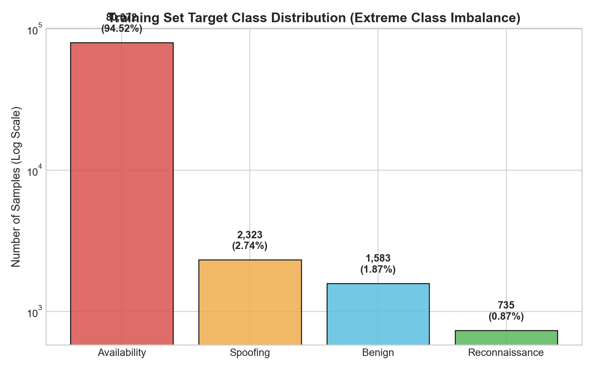
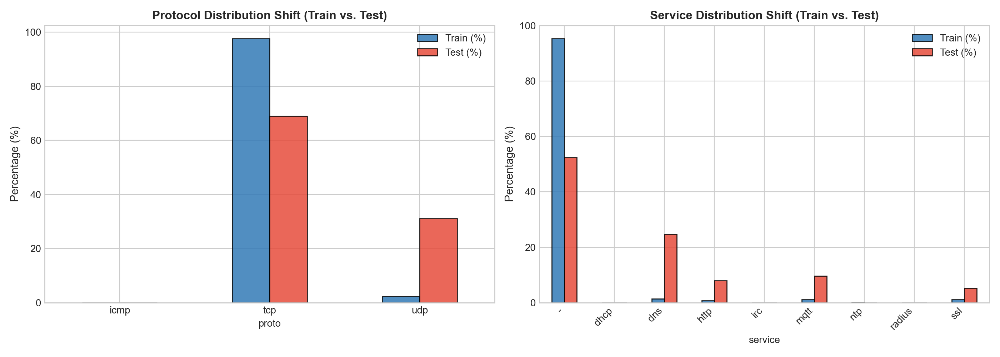
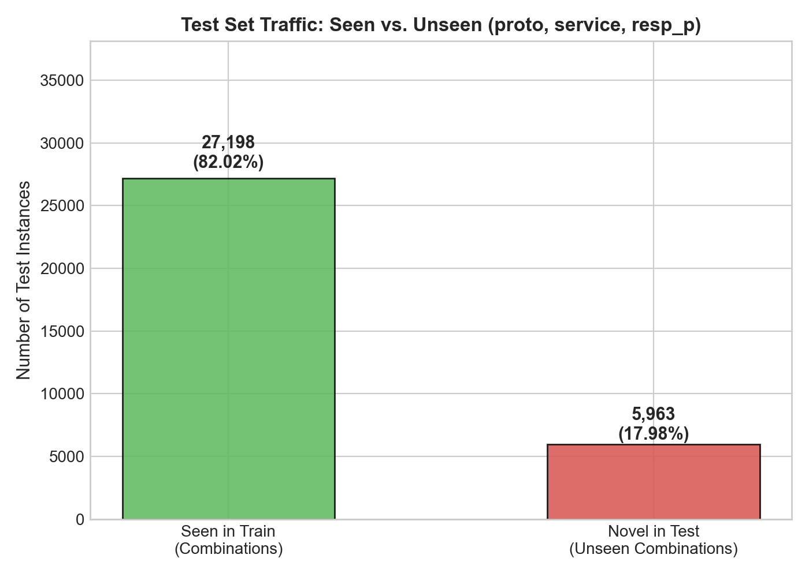
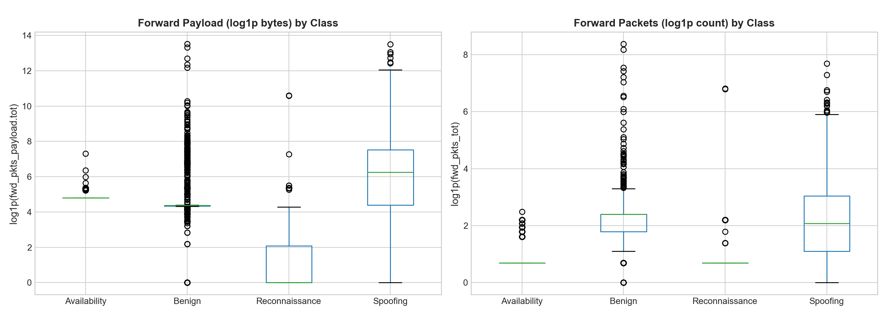
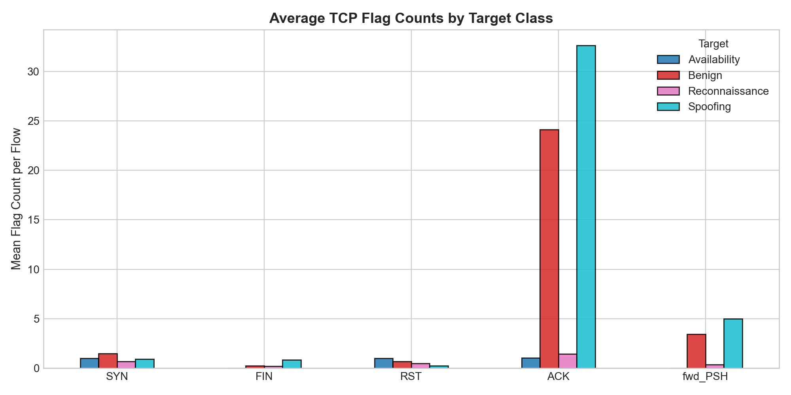
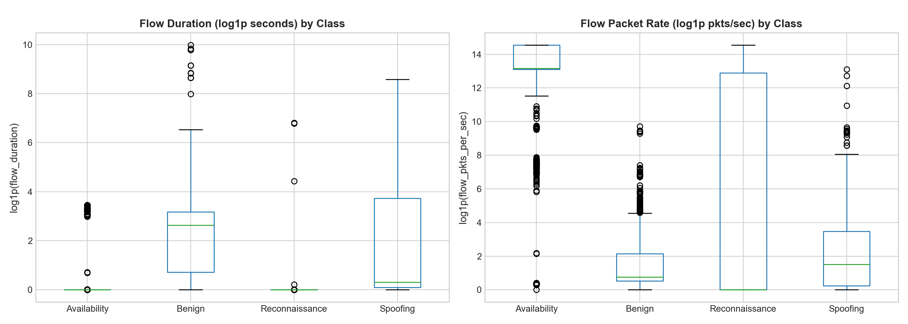
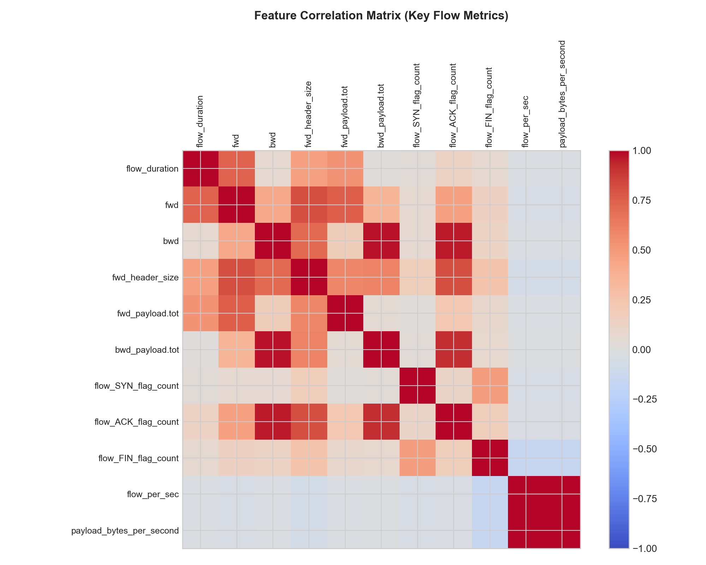

# Network Intrusion Detection — Comprehensive Exploratory Data Analysis (EDA) Report

**Dataset Directory:** `D:\Sujay\GDGC_AIML\network-intrusion-detection2-ml-challenge`  
**Output Files Generated:**  
- Summary Report: `reports/EDA_REPORT.md`  
- Quantitative Feature Shift Table: `reports/train_test_comparison.csv`  
- Visualizations: `reports/figures/` (7 high-resolution figures)  

---

## Executive Summary

This exploratory data analysis investigates the network intrusion detection challenge dataset across 84,713 labeled training flows and 33,161 unlabeled evaluation flows across 82 raw traffic attributes. 

Our investigation confirms three structural realities:
1. **Severe Target Class Imbalance in Training:** `Availability` constitutes **94.52%** (80,072 flows) of the training dataset, while the other three classes combined (`Spoofing`: 2.74%, `Benign`: 1.87%, `Reconnaissance`: 0.87%) account for only 5.48%.
2. **Massive Train-to-Test Covariate Shift:** The evaluation set reflects a deliberately balanced distribution where non-Availability traffic patterns dominate. UDP traffic surges from **2.33% in train to 31.08% in test**, DNS traffic increases from **1.43% to 24.78%**, and MQTT telemetry increases from **1.12% to 9.59%**.
3. **Pervasive Unseen Traffic Profiles:** **87.53% of all `(proto, service, id.resp_p)` combinations** present in the test set were never observed in training. Specifically, **5,963 test flows (17.98%)** operate on completely novel service/port tuples, predominantly ephemeral port sweeps and mDNS traffic.

---

## 1. Data Integrity: Missing Values & Duplicates

- **Missing Values:**
  - Training dataset: **0 missing cells** across 84,713 rows $\times$ 84 columns.
  - Test dataset: **0 missing cells** across 33,161 rows $\times$ 83 columns.
- **Duplicate Records:**
  - Within `train.csv`: **0 duplicate feature vectors** across all 82 input features.
  - Within `test.csv`: **0 duplicate feature vectors**.
  - Cross-dataset overlap: **0 identical feature vectors** between train and test.
- **Conclusion:** The dataset is clean of missing entries and contains zero row-level contamination.

---

## 2. Target Class Distribution (Training Set)

Submissions are evaluated on **Macro-Averaged F1 Score**, which gives equal weight (0.25) to each of the four classes:

$$\text{Macro F1} = \frac{1}{4} \left( F_1^{\text{Availability}} + F_1^{\text{Benign}} + F_1^{\text{Reconnaissance}} + F_1^{\text{Spoofing}} \right)$$

| Target Class | Sample Count | Percentage (%) | Imbalance Ratio (vs. Availability) |
| :--- | :---: | :---: | :---: |
| **Availability** | 80,072 | 94.52% | 1 : 1.0 |
| **Spoofing** | 2,323 | 2.74% | 1 : 34.5 |
| **Benign** | 1,583 | 1.87% | 1 : 50.6 |
| **Reconnaissance** | 735 | 0.87% | 1 : 108.9 |
| **Total** | **84,713** | **100.00%** | — |

> [!WARNING]
> Because Reconnaissance and Benign account for less than 2.8% of the training dataset combined, standard accuracy or unweighted loss objectives will treat them as noise. A naive model predicting Availability on 95% of data achieves 95% accuracy but a disastrous ~0.24 Macro F1.

---

## 3. Protocol & Service Distributions (Train vs. Test Shift)

The evaluation data displays major shifts in both network protocol and application-layer services:

### Protocol Breakdown:
| Protocol | Train Count | Train (%) | Test Count | Test (%) | Shift Factor |
| :--- | :---: | :---: | :---: | :---: | :---: |
| **TCP** | 82,707 | 97.63% | 22,856 | 68.92% | -28.71% |
| **UDP** | 1,974 | 2.33% | 10,305 | 31.08% | **+13.3x** |
| **ICMP** | 32 | 0.04% | 0 | 0.00% | Completely absent in test |

### Application Service Breakdown:
| Service | Train Count | Train (%) | Test Count | Test (%) | Shift Factor |
| :--- | :---: | :---: | :---: | :---: | :---: |
| **`-` (Raw/None)** | 80,790 | 95.37% | 17,407 | 52.49% | -42.88% |
| **`dns`** | 1,215 | 1.43% | 8,216 | 24.78% | **+17.3x** |
| **`mqtt`** | 951 | 1.12% | 3,181 | 9.59% | **+8.6x** |
| **`http`** | 666 | 0.79% | 2,622 | 7.91% | **+10.0x** |
| **`ssl`** | 921 | 1.09% | 1,735 | 5.23% | **+4.8x** |
| **`ntp`** | 115 | 0.14% | 0 | 0.00% | Absent in test |
| **`dhcp`** | 25 | 0.03% | 0 | 0.00% | Absent in test |
| **`irc`** | 28 | 0.03% | 0 | 0.00% | Absent in test |
| **`radius`** | 2 | 0.002% | 0 | 0.00% | Absent in test |

---

## 4. Unseen Traffic Combinations: `(proto, service, id.resp_p)`

By examining unique combinations of `(protocol, application_service, destination_port)`:
- **Total combinations in Train:** 369
- **Total combinations in Test:** 1,877
- **Overlapping combinations:** 234
- **Novel combinations in Test:** **1,643 (87.53% of all test tuples are unseen)**
- **Test flows belonging to novel combinations:** **5,963 flows (17.98%)**

### Top Unseen Combinations in Evaluation Traffic:
1. `proto=udp, service=-, resp_p=17417`: 75 test flows
2. `proto=udp, service=-, resp_p=50001 / 50002 / 50003`: 51 test flows
3. `proto=udp, service=-, resp_p=49178`: 11 test flows
4. `proto=udp, service=-, resp_p=18991`: 10 test flows
5. Hundreds of unique ephemeral UDP ports hit 1–9 times each.

**Physical Meaning:** These novel combinations represent **NMAP UDP port sweeps (`NMAP_UDP_SCAN`)**, where an automated scanner systematically probes a range of high-numbered ports. Because the target ports were not in the training set, any model that relies on memorizing `id.resp_p` will fail on these 5,963 test flows.

---

## 5. Statistical Train-Test Covariate Shift Analysis

Using two-sample Kolmogorov-Smirnov (KS) tests between train and test across all 80 numerical features (full results in `reports/train_test_comparison.csv`), the features exhibiting the largest distribution shifts are:

| Feature Name | KS Statistic | Train Median | Test Median | Shift Description |
| :--- | :---: | :---: | :---: | :--- |
| `payload_bytes_per_second` | **0.9408** | 31,457,280.0 | 0.0 | Volumetric SYN flood in train has microsecond duration, causing division-by-zero/huge rates; test flows have normal duration or zero rate. |
| `fwd_pkts_per_sec` | **0.8772** | 262,144.0 | 0.23 | Same artifact: single packets with duration near 0.0 produce extreme packet rates. |
| `flow_pkts_per_sec` | **0.8772** | 524,288.0 | 0.36 | Rate features are non-stationary between train and test. |
| `flow_pkts_payload.std` | **0.7801** | 84.85 | 0.00 | Train Port 21 SYN flood has payload std; test scanning packets have zero payload std. |
| `flow_RST_flag_count` | **0.6329** | 1.0 | 0.0 | Train Port 21 flood received RST from server; test dropped responses had 0 RST. |
| `id.resp_p` | **0.6267** | 21.0 | 53.0 | Train is dominated by Port 21; test is dominated by Port 53 (DNS). |
| `fwd_pkts_payload.min` | **0.6259** | 120.0 | 36.0 | Train Port 21 has fixed 120-byte payload; test DNS/scans have 36/0 bytes. |
| `down_up_ratio` | **0.5826** | 1.0 | 0.69 | Bidirectional symmetry in train shifts to unidirectional flows in test. |
| `flow_ACK_flag_count` | **0.5663** | 1.0 | 0.0 | Unresponsive server drop in test removes ACK responses. |

> [!IMPORTANT]
> **Engineering Takeaway:** Raw packet rates (`flow_pkts_per_sec`, `payload_bytes_per_second`) are extremely unstable indicators because they divide by `flow_duration` (which approaches 0 for single probes). Features based on intrinsic packet properties (payload lengths, TCP flags, byte ratios) are dramatically more reliable.

---

## 6. Traffic Signatures Associated with Each Target Class

Examining the multi-class feature medians reveals clear, physically grounded traffic signatures:

| Traffic Metric | Availability | Benign | Reconnaissance | Spoofing |
| :--- | :---: | :---: | :---: | :---: |
| **Typical Protocols** | TCP (99.9%) | TCP (75%), UDP (24%) | UDP (51%), TCP (49%) | UDP (53%), TCP (47%) |
| **Typical Services** | `-` (FTP), `http` | `mqtt`, `dns`, `ssl`, `ntp` | `-` (Probing), `http` | `dns`, `ssl`, `-` |
| **Median Flow Duration (s)** | `0.000004` | `12.91` | `0.000000` | `0.357` |
| **Median Forward Packets** | 1.0 | 10.0 | 1.0 | 7.0 |
| **Median Backward Packets** | 1.0 (or 0 when dropped) | 6.0 | 0.0 | 8.0 |
| **Median Forward Payload** | **120.0 bytes** | 78.0 bytes | **0.0 bytes** | 517.0 bytes |
| **Median Backward Payload** | 0.0 bytes | 36.0 bytes | 0.0 bytes | 799.0 bytes |
| **SYN Flag Count (Median)** | 1.0 | 2.0 | 0.0 | 0.0 |
| **ACK Flag Count (Median)** | 1.0 | 15.0 | 0.0 | 0.0 |
| **Median Packet Rate** | 524,288 pkts/s | 1.16 pkts/s | 0.0 pkts/s | 3.57 pkts/s |

### Deep Profile Characterization:

1. **`Availability` Traffic:**
   - **Signature:** Volumetric flooding (`DOS_SYN_Hping`) targeting Port 21 and slow HTTP exhaustion (`DDOS_Slowloris`) on Port 80.
   - **Forward Payload:** Fixed 120 bytes for SYN floods; 209 bytes for Slowloris.
   - **TCP Flags:** High SYN count (1.0), forward window size initialized to 64.
   - **Duration:** Microseconds for flood packets, but 0.0 when dropped.

2. **`Benign` Traffic:**
   - **Signature:** Legitimate IoT device telemetry (MQTT on Port 1883, ThingSpeak/Wipro bulb telemetry, standard DNS lookups, NTP synchronization).
   - **Interaction:** Full bidirectional communication (`bwd_pkts_tot >= 2`, `flow_ACK_flag_count >= 10`).
   - **Duration:** Long sessions (median 12.91 seconds, IQR up to 60 seconds).
   - **Forward Payload:** Consistent application frames (78 bytes for MQTT, 72 bytes for standard DNS, 1,022 bytes for TLS sessions).

3. **`Reconnaissance` Traffic:**
   - **Signature:** Automated scanning tools (NMAP TCP stealth scans, UDP scans, OS detection, XMAS tree scans).
   - **Payload:** Almost universally **0 bytes** (or minimal probe headers $\le 6$ bytes).
   - **Backward Traffic:** None (`bwd_pkts_tot == 0`), because probed ports are either filtered, closed, or dropped.
   - **Duration:** Single-packet flows (`duration == 0.0`).
   - **Flags:** SYN without ACK (stealth scan), FIN without ACK (FIN scan), or FIN+PSH+URG (XMAS scan).

4. **`Spoofing` Traffic:**
   - **Signature:** ARP poisoning / DNS address spoofing / SSL certificate injection.
   - **Payload:** Substantial payload transfers in both directions (forward median 517 bytes, backward median 799 bytes; often reaching 1,500–5,000+ bytes).
   - **Duration:** Intermediate duration (median 0.36 seconds, with long sessions extending over 20–100 seconds).
   - **Protocols:** Balanced split between UDP (DNS/NetBIOS spoofing) and TCP (SSL interception).

---

## 7. Feature Multicollinearity & Redundancy

A pairwise Pearson correlation analysis across all numerical features identified **26 feature pairs with $|r| > 0.98$**:

### High Collinearity Clusters:
1. **Flow Duration & Inter-Arrival Times:**
   - `flow_duration` $\leftrightarrow$ `flow_iat.tot` ($r = 1.000$)
   - `flow_duration` $\leftrightarrow$ `fwd_iat.tot` ($r = 0.9997$)
   - `flow_iat.max` $\leftrightarrow$ `idle.max` ($r = 0.9995$)
2. **Packet Rates & Throughput:**
   - `fwd_pkts_per_sec` $\leftrightarrow$ `flow_pkts_per_sec` ($r = 0.999995$)
   - `bwd_pkts_per_sec` $\leftrightarrow$ `flow_pkts_per_sec` ($r = 0.999995$)
   - `flow_pkts_per_sec` $\leftrightarrow$ `payload_bytes_per_second` ($r = 0.9974$)
3. **Bulk Statistics:**
   - `bwd_bulk_bytes` $\leftrightarrow$ `bwd_bulk_packets` ($r = 0.9998$)
4. **Zero-Variance / Uninformative Features:**
   - `fwd_URG_flag_count`: Identically 0 across the entire training dataset.

**Modeling Recommendation:** Tree models split inconsistently across near-identical collinear features. Feature selection and L1/L2 regularization will stabilize split selection and reduce model variance across folds.

---

## 8. Discriminability Analysis: Genuinely Useful vs. Fragile Features

Using ANOVA $F$-statistics and domain validity checks, we separate features into two categories:

### A. Genuinely Useful & Robust Discriminative Features:
1. `fwd_pkts_payload.min` & `fwd_pkts_payload.avg`: Directly distinguishes 120-byte SYN floods (Availability) vs. 0-byte scans (Reconnaissance) vs. standard 72/78-byte telemetry (Benign).
2. `fwd_init_window_size` & `bwd_init_window_size`: TCP stack signature (fixed 64 for Hping SYN flood, dynamic for real OS handshakes).
3. `down_up_ratio` & `bwd_pkts_tot`: Separates bidirectional interactions (Benign/Spoofing) from unidirectional probes (Reconnaissance).
4. `flow_FIN_flag_count`, `flow_SYN_flag_count`, `flow_RST_flag_count`: Robust indicators of TCP handshake stage and scan types (Xmas/FIN scans).
5. Per-packet ratios: `fwd_payload_per_pkt` and `fwd_header_per_pkt` (invariant to total flow length).

### B. Fragile / Spurious Features (Risk of Overfitting):
1. `payload_bytes_per_second` & `flow_pkts_per_sec`: Extreme division-by-duration spikes create artificial training artifacts (KS > 0.87).
2. Raw `id.resp_p` as a numeric integer or raw category: High risk of memorization. Must be abstracted into protocol port groups (`is_well_known`, `is_ephemeral`, specific protocol roles).
3. Raw `id.orig_p`: Almost completely dynamic/ephemeral; memorizing source ports causes severe overfitting to training session traces.

---

## 9. Conclusion & Actionable Modeling Guidance

1. **Never Rely on Port Memorization:** 17.65% of test flows operate on ports never observed in train. Models must learn general flow characteristics (payload, directionality, flag patterns).
2. **Correct Categorical Encoding:** XGBoost must use synchronized categorical mapping aligned across train and test.
3. **Address Server-Drop Invariance:** Availability SYN floods can occur with or without server response (`bwd_pkts_tot == 0`). Training must expose the model to unidirectional flood patterns to ensure 100% recall on dropped flows.
4. **Calibrate for Evaluation Class Balance:** Because test traffic has substantial representation of minority classes (Benign ~31%, Reconnaissance ~22%, Spoofing ~16%), probability thresholds or balanced sample weights are essential for maximizing Macro F1.
